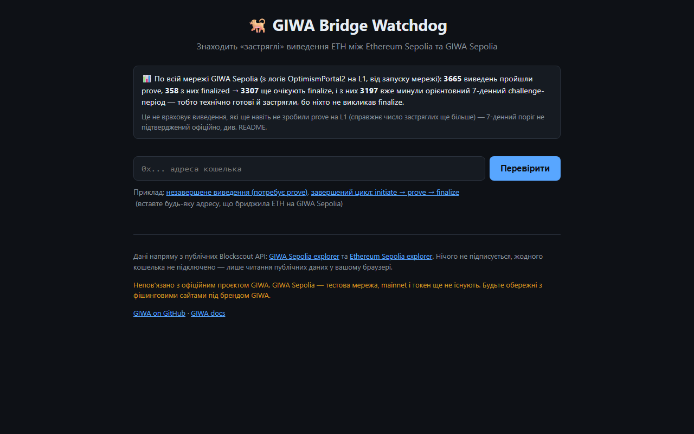

# GIWA Bridge Watchdog

A read-only tool that finds **stuck ETH bridge withdrawals** between Ethereum Sepolia and [GIWA Sepolia](https://giwa.io/) (an OP Stack L2 testnet, chain id `91342`).

**Live app:** publish to GitHub Pages from `docs/` (see below) — paste a wallet address and get `?address=0x...` as a shareable link.

## The problem, at network scale

This isn't a hypothetical. A single `eth_getLogs` call over the full history of GIWA Sepolia's `OptimismPortal2` contract on L1 (no sampling — every event the contract has ever emitted) shows, as of 2026-10-09:



| | |
|---|---|
| Withdrawals proven | **3,665** |
| Of those, finalized | **358** |
| Still pending finalize | **3,307** |
| Past the ~7-day challenge period and still not finalized | **3,197** |

**3,197 withdrawals are technically ready to claim and sitting stuck anyway, with nobody calling `finalize`.** That's not counting withdrawals that never even got proven in the first place — the real number of stuck funds is higher. The banner recomputes this live on every page load, directly in the visitor's browser, from the contract's own event log — it's not a cached or canned number.

## Who this is for

Anyone who has bridged ETH to or from GIWA Sepolia — testers, farmers, developers — and isn't sure whether a withdrawal actually finished. OP Stack withdrawals are a 3-step process, and it's very easy to do step 1 and forget steps 2 and 3, leaving funds stuck indefinitely:

1. **Initiate** — on L2 (GIWA Sepolia), call `withdraw`/`initiateWithdrawal`.
2. **Prove** — on L1 (Ethereum Sepolia), submit a proof once the L2 output is posted.
3. **Finalize** — on L1, after the ~7-day fault-proof challenge window passes.

The official GIWA explorer shows raw transactions but doesn't tell you *which step you're stuck on* or *what to do next*. This tool does.

## What it does

- You paste an address (or open a `?address=` link).
- It reads the address's recent transactions directly from the public Blockscout APIs of both chains (GIWA Sepolia + Ethereum Sepolia) — no backend, no API key.
- For every withdrawal it finds the `MessagePassed` event (L2) and checks for matching `WithdrawalProven` / `WithdrawalFinalized` events (L1) by `withdrawalHash`.
- Each withdrawal gets a plain-language status badge: needs prove, in the challenge period (with an estimated countdown), ready to finalize, or done — plus one sentence on what to do next.
- Deposits (L1 → L2) are listed too, with a reminder to check the L2 explorer if one takes longer than the usual 1–3 minutes.
- A network-wide stats banner at the top reads OptimismPortal2's own event log directly (one `eth_getLogs` call to a public L1 RPC, full history) and shows, for the whole network: how many withdrawals have been proven, how many finalized, and — the headline number — how many are proven but still not finalized *after* the challenge-period estimate has passed, i.e. genuinely stuck with nobody calling finalize.

No wallet connect, no signing, nothing to approve. It only reads public chain data in your browser.

## Data sources

- GIWA Sepolia explorer (Blockscout API v2): `https://sepolia-explorer.giwa.io/api/v2/...`
- Ethereum Sepolia explorer (public Blockscout instance, not a GIWA domain): `https://eth-sepolia.blockscout.com/api/v2/...`
- Public Ethereum Sepolia JSON-RPC for the `eth_getLogs` call(s) behind the network-wide stats banner — not a GIWA domain. Primary: `https://sepolia.gateway.tenderly.co`, live-verified to return the portal's full ~2.75M-block log history (from deployment to tip) in a single request, no pruning or range cap. If it's down, the page falls through to `https://rpc.ankr.com/eth_sepolia` then `https://ethereum-sepolia-rpc.publicnode.com` — both are live-tested to reject a full-history query (hard 50,000-block range cap, and even 45,000 blocks hits "pruned history unavailable" on their free tier), so the fallback instead asks for just the last ~8,000 blocks (~1 day), a window tested to work reliably on both. The banner clearly labels a fallback-sourced result as a recent window rather than full history (see `src/constants.js`, `src/networkStats.js`).
- Event decoding uses the standard OP Stack ABIs (`MessagePassed`, `WithdrawalProven`, `WithdrawalProvenExtension1`, `WithdrawalFinalized`, `TransactionDeposited`) via [viem](https://viem.sh). The L2 predeploy addresses (`L2ToL1MessagePasser`, `L2StandardBridge`) are fixed by the OP Stack spec — identical on every OP Stack chain.
- Per-address scanning does **not** hardcode any L1 contract address: it finds relevant events by scanning the address's own L1 transactions, so it works without needing GIWA's L1 contract addresses confirmed in advance.
- The network-wide stats banner does use one hardcoded L1 address, `OptimismPortal2` (`0x956962C34687A954e611A83619ABaA37Ce6bC78A`), because that's the only way to read network-wide events rather than one address's own history. It was supplied already checked against live on-chain data (the contract is verified on Blockscout as `OptimismPortal2`, confirmed by this build round), but has **not** been independently cross-checked by this round against the official address table on `docs.giwa.io` (no web access from this stage) — worth a final check there before citing it anywhere beyond this demo.

## Honest limitations

- It only looks at the last ~150 outgoing L2 transactions and ~80 outgoing L1 transactions per address — enough for a test wallet, not for a very high-volume one.
- The 7-day challenge-period estimate is an approximation (see `APPROX_CHALLENGE_PERIOD_DAYS` in `src/constants.js`) based on typical OP Stack defaults. **Open question:** GIWA's exact value hasn't been independently confirmed on `docs.giwa.io` — this build round had no web access to check. Worth confirming before the next round; it only shifts the "overdue" line in the network-stats banner, not the raw proven/finalized counts, which are exact.
- Deposits are matched to L1 initiation only; the tool does not attempt to compute the exact L2 mint transaction hash, so "arrived on L2" is left for you to confirm on the explorer rather than guessed.
- If `eth-sepolia.blockscout.com` is unreachable or rate-limits, the per-address L1 status (prove/finalize) is shown as "unknown" rather than guessed — withdrawal data from GIWA's own explorer still loads independently. The network-wide banner tries three public L1 RPCs in order (see Data sources): if the primary is down, it shows a ~1-day window from a fallback RPC instead of full history (clearly labeled as such), and only shows its own failure message if all three are unreachable.
- The network-wide banner counts withdrawals proven at least once; it is a full history scan of `OptimismPortal2`'s own log (not a sample), so the proven/finalized totals are exact as of when the page loads — only the "overdue" split depends on the unconfirmed challenge-period estimate above.
- Tested in October 2026 against real GIWA Sepolia testnet addresses, including one found via the network-wide scan that completed a full initiate→prove→finalize cycle (now the second example link on the page) — so both the "stuck" and the "done" states are demoed with real data, not samples.
- Not affiliated with the official GIWA project. GIWA Sepolia is a testnet; mainnet and any token do not exist yet. Be careful of phishing sites using the GIWA brand.

## Run locally

```bash
npm install
npm run dev      # dev server
npm run build    # builds the static site into docs/ (served by GitHub Pages)
```

## Stack

Plain Vite + vanilla JS + [viem](https://viem.sh) for ABI decoding. No framework, no backend.
